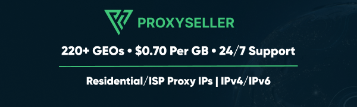
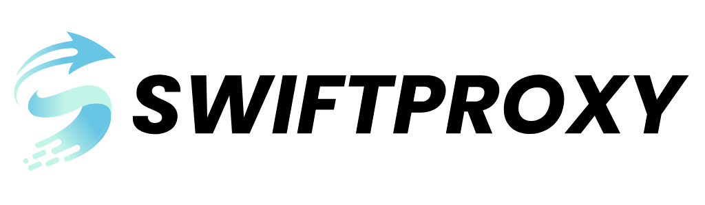
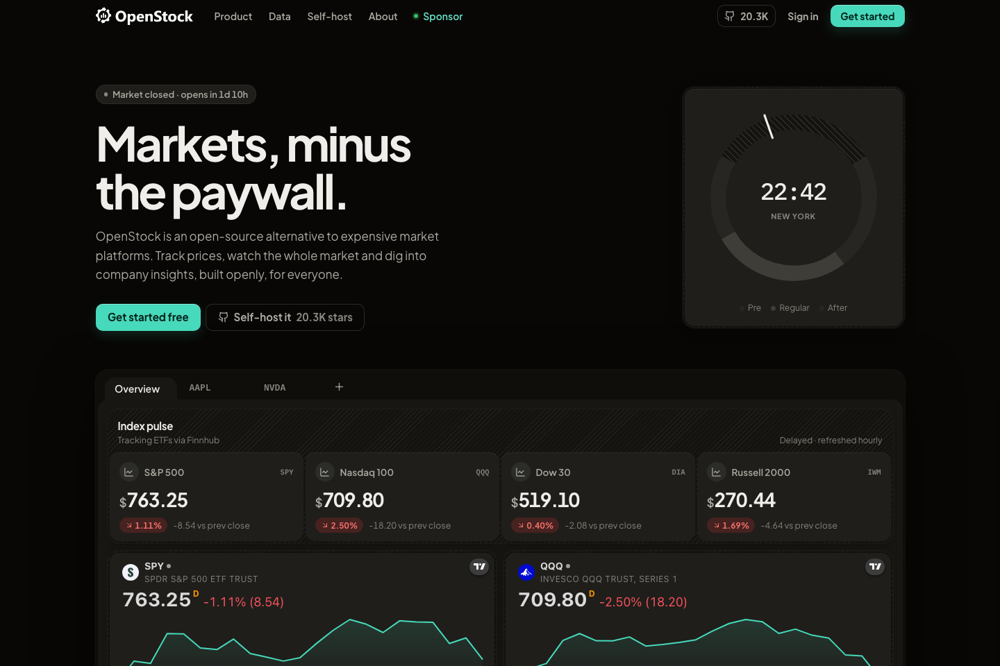

<p align="center"><sub><a href="#sponsors">SPONSORED BY</a></sub></p>

<p align="center">
  <a href="https://proxy-seller.com/?partner=0PC6QUN0HW8FI0"></a>
</p>

<p align="center">
  <a href="https://www.swiftproxy.net/?ref=OpenStock"><picture><source media="(prefers-color-scheme: dark)" srcset="eco/web/public/assets/images/swiftproxy-logo.png"></picture></a>
</p>

<p align="center">
  <a href="https://github.com/diip3sh/orbit"><picture><source media="(prefers-color-scheme: dark)" srcset="eco/web/public/assets/icons/orbit.png"></picture></a> <a href="https://github.com/diip3sh/orbit"><b>Orbit</b></a>. Free, open-source macOS screen recorder, screenshot tool and video editor: auto-zoom, smooth cursor, backgrounds, web recordings and AI agent recording.
</p>

<p align="center">
 <a href="https://www.star-history.com/open-dev-society/openstock">
  <picture><source media="(prefers-color-scheme: dark)" srcset="https://api.star-history.com/badge?repo=Open-Dev-Society/OpenStock&type=rank&theme=dark" /><source media="(prefers-color-scheme: light)" srcset="https://api.star-history.com/badge?repo=Open-Dev-Society/OpenStock&type=rank" /></picture> <picture><source media="(prefers-color-scheme: dark)" srcset="https://api.star-history.com/badge?repo=Open-Dev-Society/OpenStock&type=trending&theme=dark" /><source media="(prefers-color-scheme: light)" srcset="https://api.star-history.com/badge?repo=Open-Dev-Society/OpenStock&type=trending" /></picture>
 </a>
</p>

<p align="center">
  <a href="https://trendshift.io/repositories/15728?utm_source=repository-badge&amp;utm_medium=badge&amp;utm_campaign=badge-repository-15728" target="_blank" rel="noopener noreferrer"></a>
  <a href="https://trendshift.io/repositories/15728?utm_source=trendshift-badge&amp;utm_medium=badge&amp;utm_campaign=badge-trendshift-15728" target="_blank" rel="noopener noreferrer"></a>
  <a href="https://trendshift.io/repositories/15728?utm_source=trendshift-badge&amp;utm_medium=badge&amp;utm_campaign=badge-trendshift-15728" target="_blank" rel="noopener noreferrer"></a>
  <a href="https://trendshift.io/repositories/15728?utm_source=trendshift-badge&amp;utm_medium=badge&amp;utm_campaign=badge-trendshift-15728" target="_blank" rel="noopener noreferrer"></a>
  <a href="https://idmo.app/p/openstock" target="_blank" rel="noopener noreferrer"></a>

</p>
<div align="center">
  <br />
  <a href="https://openstock-ods.vercel.app"></a>
  <br />
  <br />

  **[Open OpenStock](https://openstock-ods.vercel.app)** · [Changelog](https://openstock-ods.vercel.app/changelog) · [Self-host it](#self-hosting) · [Sponsor](#sponsors) · [Discord](https://discord.gg/JkJ8kfxgxB)

  <br />

  <div>
    <a href="https://github.com/Open-Dev-Society/OpenStock/releases/latest"></a>
    
    
    
    
    
  </div>
</div>

# OpenStock

**Markets, minus the paywall.** OpenStock is a free, open-source alternative to expensive market platforms: track prices, watch the whole market and dig into company insights. Use it at [openstock-ods.vercel.app](https://openstock-ods.vercel.app), or run your own copy with every feature.

> ❤️ **13,000+ people use OpenStock for free.** Help keep it that way: [sponsor from $5 a month](https://github.com/sponsors/ravixalgorithm/sponsorships?frequency=recurring&amount=5), or read [how OpenStock is funded](#sponsors).

> [!NOTE]
> OpenStock is community-built and not a brokerage. Market data may be delayed depending on the provider and your setup. Nothing here is financial advice.

## 📋 Table of Contents

1. 🔋 [Features](#features)
2. ⏱️ [How fresh is the data](#data-freshness)
3. ⚙️ [Tech stack](#tech-stack)
4. 🤸 [Quick start](#quick-start)
5. 🔐 [Environment variables](#environment-variables)
6. 🐳 [Self-hosting](#self-hosting): Docker, prebuilt image, Railway
7. 🧱 [Project structure](#project-structure)
8. 📡 [How it works](#data--integrations)
9. 🌍 [Market support](#market-support)
10. 🧪 [Scripts and tests](#scripts--tooling)
11. 🤝 [Contributing](#contributing)
12. 🏆 [Contributors](#contributors)
13. 🛡️ [Security](#security)
14. 📜 [License](#license)
15. 🌱 [Open Dev Society manifesto](#manifesto)
16. 🙏 [Acknowledgements](#acknowledgements)
17. ❤️ [Sponsor OpenStock](#sponsors)

## 🔋 Features <a name="features"></a>

**Markets**
- A dashboard for nine markets: US, India, Germany, Canada, Australia, Saudi Arabia, Poland, Crypto and Forex, with an index pulse and top stories, plus a heatmap and market leaders, or for Saudi Arabia and Poland today's movers and a quotes table priced from Yahoo Finance.
- Search every exchange Finnhub covers with **⌘K**, and keep stocks open as browser-style tabs.

**Stock pages**
- TradingView candles with drawing tools (trend lines, Fibonacci, shapes, text) and fullscreen.
- Pick indicators once (SMA, EMA, Bollinger Bands, VWAP, RSI, MACD, Stochastic, ATR) and they stay on every chart.
- Financials, technicals, the company profile and the dividend yield.
- Sentiment from Reddit, X, news and Polymarket (with an Adanos key).
- Recent news rated 1 to 10 for relevance, with what each story means for the stock (with an AlphAI key).

**Watchlist and alerts**
- A starred watchlist of up to 50 stocks, plus up to 10 named lists of 50, saved to your account. File a stock into a list from any watchlist row or straight from search.
- Price alerts above or below a target, or when the price crosses its 20, 50, 100 or 200-day moving average, checked every 5 minutes and emailed to you (in realtime mode).
- A weekly, AI-written news digest by email every Monday.

**Accounts**
- Email and password, plus Google and GitHub sign-in when configured; password reset and a profile page.
- Rate-limited sign-in, sign-up and password reset; resetting your password signs out your other devices.

**Languages and devices**
- The app, sign-in pages and emails in English, Polish and Arabic (laid out right to left), from your browser's language or the Language menu in the sidebar. The public site is in English.
- Fits phones and tablets from 320px wide.

**Public pages**
- A TradingView chart and the latest SEC filings for every S&P 500 and Nasdaq-100 company at `/s/<ticker>`, and plain comparison guides at `/compare`, with no account needed.

**Community**
- A [changelog](https://openstock-ods.vercel.app/changelog) that credits everyone who contributed, a [Wall of love](https://openstock-ods.vercel.app/love), and an update banner in the app.

## ⏱️ How fresh is the data <a name="data-freshness"></a>

Charts come from TradingView: live for most markets, end of day for some. Quotes, watchlist prices and alerts come from Finnhub:

| | Quotes | Price alerts | Cost |
|---|---|---|---|
| **Community**: [openstock-ods.vercel.app](https://openstock-ods.vercel.app) | Every hour, shared by everyone | No | Free |
| **OpenStock Cloud** (coming soon) | Every 15 seconds | By email | $5 a month |
| **Self-hosted** | Every hour, or every 15 seconds with `NEXT_PUBLIC_OPENSTOCK_DATA_MODE=realtime` and your own Finnhub keys | By email, in realtime mode | Free |

Saudi and Polish prices come from Yahoo Finance, delayed, on every deployment, because TradingView embeds block Tadawul and show Warsaw only end of day.

## ⚙️ Tech stack <a name="tech-stack"></a>

| | |
|---|---|
| App | [Jac](https://github.com/jaseci-labs/neojac), compiled by neojac into one self-contained program: a native server and React 19 pages, Tailwind CSS v4, English, Polish and Arabic |
| Accounts and data | neojac's accounts and its kept graph (SQLite files in the app's data directory); no database to run |
| Market data | Finnhub, TradingView widgets, Yahoo Finance (Saudi and Polish quotes), Adanos (sentiment), AlphAI (scored news) |
| Background jobs | Scheduled functions inside the app |
| Email | SMTP (Gmail) for welcome and alert emails, Kit for the newsletter |
| AI | Gemini, MiniMax or Siray |
| Hosting | The program itself, or the Docker image on GitHub Container Registry |

## 🤸 Quick start <a name="quick-start"></a>

You need [neojac](https://github.com/jaseci-labs/neojac) 0.5.1 and a free [Finnhub](https://finnhub.io) key.

```bash
curl -fsSL https://github.com/jaseci-labs/neojac/releases/latest/download/install.sh | bash -s -- --version 0.5.1
git clone https://github.com/Open-Dev-Society/OpenStock.git
cd OpenStock
neojac install                    # the pages' npm packages
cp .env.example .env              # fill in FINNHUB_API_KEY
neojac run tools/check_env.jac    # checks your .env
set -a; . ./.env; set +a          # the app reads its environment; it does not read .env itself
neojac run web                    # http://127.0.0.1:8000
```

`neojac dev web` rebuilds as you edit. For production, `neojac build web` writes `dist/web-<platform>/`: copy that directory, `messages/` and `data/` to a machine of the same platform and run `./web` there. Nothing else needs to be installed.

Welcome emails, price alerts and the weekly digest run inside the app; there is no separate job service.

## 🔐 Environment variables <a name="environment-variables"></a>

Every variable is listed with comments in [`.env.example`](.env.example). The ones that matter:

| Variable | Needed | What it's for |
|---|---|---|
| `FINNHUB_API_KEY` | Yes | Market data. Or put several free keys, comma-separated, in `FINNHUB_API_KEYS`: they're rotated, and each adds 60 requests a minute |
| `BETTER_AUTH_URL` | Yes | The app's public URL, used in the sitemap and canonical links |
| `JAC_WEB_LISTEN`, `JAC_WEB_DATA` | No | The address to listen on (default `127.0.0.1:8000`) and where accounts, watchlists and alerts are kept |
| `NEXT_PUBLIC_OPENSTOCK_DATA_MODE` | No | `cached` (hourly, the default) or `realtime` (every 15 seconds, with price alerts). Read when the app starts |
| `NODEMAILER_EMAIL`, `NODEMAILER_PASSWORD` | No | Welcome and alert emails through Gmail, with an app password. Without them, those emails are skipped |
| `JAC_AUTH_ORIGIN`, `JAC_MAIL_HOST`, `JAC_MAIL_SENDER`, `JAC_MAIL_USER`, `SMTP_PASSWORD` | No | Password-reset links, mailed over any SMTP server. Without them, no reset links are mailed |
| `GEMINI_API_KEY` (or MiniMax or Siray) | No | AI-written welcome emails and the news digest |
| `ADANOS_API_KEY` | No | The sentiment card on stock pages |
| `ALPHAI_API_KEY` | No | The scored news card on stock pages |
| `KIT_API_KEY`, `KIT_API_SECRET`, `KIT_WELCOME_FORM_ID` | No | The weekly digest newsletter in Kit |
| `SSO_GITHUB_CLIENT_ID` / `_SECRET`, `SSO_GOOGLE_CLIENT_ID` / `_SECRET` | No | Social sign-in. Callbacks: `<JAC_AUTH_ORIGIN>/__jac/auth/github` and `/google` |

`NEXT_PUBLIC_FINNHUB_API_KEY` still works as a name for the Finnhub key. No key is ever sent to the browser.

## 🐳 Self-hosting <a name="self-hosting"></a>

### Docker Compose <a name="docker-setup"></a>

1. Fill in `.env` (see above).
2. Start it: `docker compose up -d --build`
3. Open http://localhost:3000

The image build needs no secrets: every variable is read when the container starts. Accounts, watchlists and alerts live in the `openstock-data` volume; there is no database container.

### Prebuilt image

Every push to `main` publishes `ghcr.io/open-dev-society/openstock`, tagged `latest`, `sha-<commit>`, and a version for each release (for example `2026.10.18`). To use it, replace `build: .` under `openstock` in `docker-compose.yml` with:

```yaml
    image: ghcr.io/open-dev-society/openstock:latest
```

then run `docker compose pull && docker compose up -d`.

### Railway <a name="deploy-on-railway"></a>

OpenStock ships a [`railway.json`](railway.json) that builds the `Dockerfile`, checks health on `/sign-in` and restarts on failure.

1. Add a service from this repository (`+ New → GitHub Repo`) and attach a volume mounted at `/data`.
2. In the service's **Variables**, set:
   ```env
   BETTER_AUTH_URL=https://${{RAILWAY_PUBLIC_DOMAIN}}
   JAC_AUTH_ORIGIN=https://${{RAILWAY_PUBLIC_DOMAIN}}
   FINNHUB_API_KEY=your_finnhub_key
   GEMINI_API_KEY=your_gemini_api_key
   NODEMAILER_EMAIL=youraddress@gmail.com
   NODEMAILER_PASSWORD=your_gmail_app_password
   ```
3. Under **Settings → Networking**, generate a public domain for port 3000 and redeploy.

To turn on realtime mode, also set `NEXT_PUBLIC_OPENSTOCK_DATA_MODE=realtime`.

## 🧱 Project structure <a name="project-structure"></a>

```
archwire.jac      the app: a native server space (api/), a browser space (pages/, ui/), and what each module imports
jac.toml          project settings and the pages' npm packages
api/              the server: markets, quotes, portfolio (watchlist, named lists, alerts), jobs (welcome email,
                  alert checker, weekly digest), mail, insights (sentiment, scored news), ai, kit, seo, account
pages/            one file per route: landing, about, help, api-docs, sponsor, love, changelog, terms, s/, compare/,
                  sign-in, sign-up, forgot-password, reset-password, dashboard, watchlist, stocks, profile
ui/               components: shell (sidebar, tabs, search), market (TradingView, pulse tiles), forms, kit, i18n, site
model.jac, insight_model.jac, rules.jac, content/
                  types, pure helpers and content (changelog, sponsors, comparison guides) shared by server and pages
messages/         the English, Polish and Arabic strings
data/             the US ticker index behind /s
tools/            check_env.jac, build_tickers.jac
styles/, eco/web/ the style sheet, the HTML shell, Vite configuration and static assets
*.test.jac        tests, beside the modules they test
```

## 📡 How it works <a name="data--integrations"></a>

- **Finnhub**: search, quotes, company profiles and news. Responses are cached and shared (for an hour, or 15 seconds in realtime mode), with timeouts and a key pool, so a slow upstream never hangs a page.
- **TradingView**: the chart, heatmap, financials, technicals and profile widgets.
- **Yahoo Finance**: delayed quotes for Saudi Arabia and Poland on the dashboard, stock pages and watchlist.
- **Adanos** (optional): the sentiment card.
- **AlphAI** (optional): the scored news card.
- **Accounts and data**: neojac's accounts plugin signs people in, and each account's watchlist, lists, alerts and profile hang off its own root in the app's kept graph. Server functions tagged `:protect` only run for a signed-in caller.
- **Background jobs** are scheduled functions in `api/jobs.jac`:

  | Job | When |
  |---|---|
  | AI-personalised welcome email | On sign-up |
  | Price alert check | Every 5 minutes, in realtime mode |
  | Weekly news digest (a Kit broadcast) | Mondays at 09:00 UTC |

- **Email**: SMTP (Gmail) sends welcome and alert emails; the accounts plugin mails password-reset links; Kit sends the weekly digest.

## 🌍 Market support <a name="market-support"></a>

| Market | Charts (TradingView embeds) | Quotes, watchlist prices, alerts (Finnhub free) |
|---|---|---|
| 🇺🇸 United States | Live | Yes |
| Crypto (Binance pairs) | Live | Yes |
| Forex | Live | No |
| 🇨🇦 Canada, 🇦🇺 Australia | Delayed | No |
| 🇸🇦 Saudi Arabia (Tadawul) | Blocked; delayed Yahoo Finance quotes instead | No |
| 🇵🇱 Poland (GPW Warsaw) | End of day; delayed Yahoo Finance quotes on the dashboard | No |
| 🇮🇳 India (BSE; `.NS` symbols chart on BSE), 🇩🇪 Germany | End of day | No |
| London, Tokyo, Hong Kong, Korea and others | Candles blocked; financials, technicals and profile work | No |

The full table, and why some markets are limited, is in [MARKET_SUPPORT.md](MARKET_SUPPORT.md).

## 🧪 Scripts and tests <a name="scripts--tooling"></a>

| Command | What it does |
|---|---|
| `neojac dev web` | Runs the app and rebuilds as you edit |
| `neojac build web`, `neojac run web` | Production build, and build then run |
| `neojac check web` | Checks the whole app: syntax, names, types, wires. Run it before opening a PR |
| `neojac test` | The tests (`neojac test api/quotes.jac` for one module) |
| `neojac fmt .` | Formats the Jac source |
| `neojac run tools/check_env.jac` | Checks your `.env` |

## 🤝 Contributing <a name="contributing"></a>

You belong here. Whether you're a student, a self-taught dev or a seasoned engineer, contributions are welcome.

1. Pick a [good first issue](https://github.com/Open-Dev-Society/OpenStock/issues?q=is%3Aopen+label%3A%22good+first+issue%22), or open an issue to talk about an idea or a bug first.
2. Fork the repo, branch from `main`, then `neojac install` and `cp .env.example .env`.
3. Keep the pull request focused: a test for new logic, a screenshot for UI changes.
4. Before you open it, run `neojac check web`, `neojac test` and `neojac fmt --check .`.

Every merged pull request, and every issue that leads to a fix, is credited on the [changelog](https://openstock-ods.vercel.app/changelog) and below. Be kind, guide beginners, no gatekeeping: that's the Open Dev Society way. Participation is covered by the [Code of Conduct](CODE_OF_CONDUCT.md).

## 🏆 Contributors <a name="contributors"></a>

OpenStock is built by everyone below: the people who wrote the code and the people whose issues led to a fix. Every release, and who made it happen, is on the [changelog](https://openstock-ods.vercel.app/changelog#contributors).

[@ravixalgorithm](https://github.com/ravixalgorithm) founded and maintains OpenStock, and built it from the ground up: authentication, UI design, API and AI integration, and deployment.

<!-- Generated from the credits in lib/changelog.ts: update both together. -->
<table>
  <tr>
    <td align="center" width="16%"><a href="https://github.com/ravixalgorithm"><br/><sub><b>ravixalgorithm</b></sub></a><br/><sub>Maintainer · 54 PRs</sub></td>
    <td align="center" width="16%"><a href="https://github.com/keshav-005"><br/><sub><b>keshav-005</b></sub></a><br/><sub>7 PRs</sub></td>
    <td align="center" width="16%"><a href="https://github.com/ahmaddirar-ios"><br/><sub><b>ahmaddirar-ios</b></sub></a><br/><sub>3 PRs</sub></td>
    <td align="center" width="16%"><a href="https://github.com/gugamorato-svg"><br/><sub><b>gugamorato-svg</b></sub></a><br/><sub>3 PRs</sub></td>
    <td align="center" width="16%"><a href="https://github.com/octo-patch"><br/><sub><b>octo-patch</b></sub></a><br/><sub>3 PRs</sub></td>
    <td align="center" width="16%"><a href="https://github.com/pawisoon"><br/><sub><b>pawisoon</b></sub></a><br/><sub>3 PRs</sub></td>
  </tr>
  <tr>
    <td align="center" width="16%"><a href="https://github.com/akoweicollinxx"><br/><sub><b>akoweicollinxx</b></sub></a><br/><sub>2 PRs</sub></td>
    <td align="center" width="16%"><a href="https://github.com/alexander-schneider"><br/><sub><b>alexander-schneider</b></sub></a><br/><sub>1 PR</sub></td>
    <td align="center" width="16%"><a href="https://github.com/BambaSatoru"><br/><sub><b>BambaSatoru</b></sub></a><br/><sub>1 PR</sub></td>
    <td align="center" width="16%"><a href="https://github.com/Bortlesboat"><br/><sub><b>Bortlesboat</b></sub></a><br/><sub>1 PR</sub></td>
    <td align="center" width="16%"><a href="https://github.com/chinnsenn"><br/><sub><b>chinnsenn</b></sub></a><br/><sub>1 PR</sub></td>
    <td align="center" width="16%"><a href="https://github.com/Chukwuebuka-2003"><br/><sub><b>Chukwuebuka-2003</b></sub></a><br/><sub>1 PR</sub></td>
  </tr>
  <tr>
    <td align="center" width="16%"><a href="https://github.com/cosark"><br/><sub><b>cosark</b></sub></a><br/><sub>1 PR</sub></td>
    <td align="center" width="16%"><a href="https://github.com/cosmind-rusu"><br/><sub><b>cosmind-rusu</b></sub></a><br/><sub>1 PR</sub></td>
    <td align="center" width="16%"><a href="https://github.com/CrixusWen"><br/><sub><b>CrixusWen</b></sub></a><br/><sub>1 PR</sub></td>
    <td align="center" width="16%"><a href="https://github.com/dajiaohuang"><br/><sub><b>dajiaohuang</b></sub></a><br/><sub>1 PR</sub></td>
    <td align="center" width="16%"><a href="https://github.com/ettoreciolli"><br/><sub><b>ettoreciolli</b></sub></a><br/><sub>1 PR</sub></td>
    <td align="center" width="16%"><a href="https://github.com/fuxicodex"><br/><sub><b>fuxicodex</b></sub></a><br/><sub>1 PR</sub></td>
  </tr>
  <tr>
    <td align="center" width="16%"><a href="https://github.com/inshu5757"><br/><sub><b>inshu5757</b></sub></a><br/><sub>1 PR</sub></td>
    <td align="center" width="16%"><a href="https://github.com/kuishou68"><br/><sub><b>kuishou68</b></sub></a><br/><sub>1 PR</sub></td>
    <td align="center" width="16%"><a href="https://github.com/makeev"><br/><sub><b>makeev</b></sub></a><br/><sub>1 PR</sub></td>
    <td align="center" width="16%"><a href="https://github.com/mhatipog"><br/><sub><b>mhatipog</b></sub></a><br/><sub>1 PR</sub></td>
    <td align="center" width="16%"><a href="https://github.com/mjmcg"><br/><sub><b>mjmcg</b></sub></a><br/><sub>1 PR</sub></td>
    <td align="center" width="16%"><a href="https://github.com/Mubashirrrr"><br/><sub><b>Mubashirrrr</b></sub></a><br/><sub>1 PR</sub></td>
  </tr>
  <tr>
    <td align="center" width="16%"><a href="https://github.com/muskanbandta23"><br/><sub><b>muskanbandta23</b></sub></a><br/><sub>1 PR</sub></td>
    <td align="center" width="16%"><a href="https://github.com/nb-src"><br/><sub><b>nb-src</b></sub></a><br/><sub>1 PR</sub></td>
    <td align="center" width="16%"><a href="https://github.com/NicolasBohn"><br/><sub><b>NicolasBohn</b></sub></a><br/><sub>1 PR</sub></td>
    <td align="center" width="16%"><a href="https://github.com/parmeetkxur"><br/><sub><b>parmeetkxur</b></sub></a><br/><sub>1 PR</sub></td>
    <td align="center" width="16%"><a href="https://github.com/samki6576"><br/><sub><b>samki6576</b></sub></a><br/><sub>1 PR</sub></td>
    <td align="center" width="16%"><a href="https://github.com/TPTBusiness"><br/><sub><b>TPTBusiness</b></sub></a><br/><sub>1 PR</sub></td>
  </tr>
  <tr>
    <td align="center" width="16%"><a href="https://github.com/Yi-111-a"><br/><sub><b>Yi-111-a</b></sub></a><br/><sub>1 PR</sub></td>
    <td align="center" width="16%"><a href="https://github.com/nexitpl"><br/><sub><b>nexitpl</b></sub></a><br/><sub>6 issues</sub></td>
    <td align="center" width="16%"><a href="https://github.com/soarkit"><br/><sub><b>soarkit</b></sub></a><br/><sub>6 issues</sub></td>
    <td align="center" width="16%"><a href="https://github.com/a-lacruz"><br/><sub><b>a-lacruz</b></sub></a><br/><sub>1 issue</sub></td>
    <td align="center" width="16%"><a href="https://github.com/aaronwork1205"><br/><sub><b>aaronwork1205</b></sub></a><br/><sub>1 issue</sub></td>
    <td align="center" width="16%"><a href="https://github.com/brainistry10"><br/><sub><b>brainistry10</b></sub></a><br/><sub>1 issue</sub></td>
  </tr>
  <tr>
    <td align="center" width="16%"><a href="https://github.com/cn-zeus-jp"><br/><sub><b>cn-zeus-jp</b></sub></a><br/><sub>1 issue</sub></td>
    <td align="center" width="16%"><a href="https://github.com/danieldanielecki"><br/><sub><b>danieldanielecki</b></sub></a><br/><sub>1 issue</sub></td>
    <td align="center" width="16%"><a href="https://github.com/Greatz08"><br/><sub><b>Greatz08</b></sub></a><br/><sub>1 issue</sub></td>
    <td align="center" width="16%"><a href="https://github.com/juipeter-pixel"><br/><sub><b>juipeter-pixel</b></sub></a><br/><sub>1 issue</sub></td>
    <td align="center" width="16%"><a href="https://github.com/k2alzhang"><br/><sub><b>k2alzhang</b></sub></a><br/><sub>1 issue</sub></td>
    <td align="center" width="16%"><a href="https://github.com/khajaG321"><br/><sub><b>khajaG321</b></sub></a><br/><sub>1 issue</sub></td>
  </tr>
  <tr>
    <td align="center" width="16%"><a href="https://github.com/kumetin"><br/><sub><b>kumetin</b></sub></a><br/><sub>1 issue</sub></td>
    <td align="center" width="16%"><a href="https://github.com/maplelaef0320"><br/><sub><b>maplelaef0320</b></sub></a><br/><sub>1 issue</sub></td>
    <td align="center" width="16%"><a href="https://github.com/maxsyst"><br/><sub><b>maxsyst</b></sub></a><br/><sub>1 issue</sub></td>
    <td align="center" width="16%"><a href="https://github.com/raclure"><br/><sub><b>raclure</b></sub></a><br/><sub>1 issue</sub></td>
    <td align="center" width="16%"><a href="https://github.com/saschabrockel"><br/><sub><b>saschabrockel</b></sub></a><br/><sub>1 issue</sub></td>
    <td align="center" width="16%"><a href="https://github.com/soonfatt"><br/><sub><b>soonfatt</b></sub></a><br/><sub>1 issue</sub></td>
  </tr>
  <tr>
    <td align="center" width="16%"><a href="https://github.com/Terry0930"><br/><sub><b>Terry0930</b></sub></a><br/><sub>1 issue</sub></td>
  </tr>
</table>

Also thanks to **Priyanshuu00007**, who designed the OpenStock logo and visual identity, and **koevoet1221**, who fixed the MongoDB Docker build. Their GitHub accounts are no longer available, so they aren't linked above.

Want to be here? Pick a [good first issue](https://github.com/Open-Dev-Society/OpenStock/issues?q=is%3Aopen+label%3A%22good+first+issue%22) or report a bug you hit.

## 🛡️ Security <a name="security"></a>

Found a vulnerability? Please don't open a public issue. [Report it privately on GitHub](https://github.com/Open-Dev-Society/OpenStock/security/advisories/new); we'll work on a fix with you and credit you.

## 📜 License <a name="license"></a>

OpenStock is and will remain free and open for everyone. It's licensed under [AGPL-3.0](LICENSE): if you modify, redistribute or deploy it (including as a web service), you must release your source code under the same license and credit the original authors.

## 🌱 Open Dev Society manifesto <a name="manifesto"></a>

We live in a world where knowledge is hidden behind paywalls. Where tools are locked in subscriptions. Where information is twisted by bias. Where newcomers are told they’re not “good enough” to build.

We believe there’s a better way.

- **Our belief:** technology should belong to everyone. Knowledge should be open, free and accessible. Communities should welcome newcomers with trust, not gatekeeping.
- **Our mission:** build free, open-source projects that make a real difference: tools professionals and students can use without barriers, knowledge platforms where learning is free forever, communities where every beginner is guided, not judged, and resources that run on trust, not profit.
- **Our promise:** we will never lock knowledge. We will never charge for access. We will never trade trust for money. We run on transparency, donations and the strength of our community.
- **Our call:** if you’ve ever felt you didn’t belong, struggled to find free resources, or wanted to build something meaningful, you belong here.

Because the future belongs to those who build it openly.

## 🙏 Acknowledgements <a name="acknowledgements"></a>

- [Finnhub](https://finnhub.io) for accessible market data, and [TradingView](https://www.tradingview.com) for embeddable charts and widgets
- [Adanos](https://adanos.org) for sentiment data
- [AlphAI](https://alphai.io) for scored financial news
- Tailwind CSS, React, and neojac, the Jac compiler OpenStock is built with
- [Inngest](https://www.inngest.com) for dependable background jobs, and [Better Auth](https://www.better-auth.com) for simple, secure authentication
- [Adrian Hajdin (JavaScript Mastery)](https://github.com/adrianhajdin), whose [Stock Market App tutorial](https://www.youtube.com/watch?v=gu4pafNCXng) was where OpenStock started

Built openly, for everyone, forever free. © Open Dev Society.

## ❤️ Sponsor OpenStock <a name="sponsors"></a>

OpenStock is free, open source and used by **13,000+ registered people**. Keeping it that way costs money every month: hosting, the database, market data keys, AI and email, and the hours that go into reviewing pull requests and shipping fixes.

**How OpenStock is funded**

- **OpenStock Cloud will pay for hosting.** Cloud ($5 a month, coming soon) adds live quotes and email price alerts. Its subscribers will cover the servers, database and market data the hosted app needs, so the free site stays online without depending on donations.
- **Sponsors keep the community moving.** Sponsorships pay for the time behind OpenStock: reviewing community pull requests, fixing bugs and shipping features at the pace 13,000+ people expect, with the core free for everyone. Self-hosting stays free, with every feature.

**Pick a tier.** Each link opens GitHub Sponsors with the amount already selected. Cancel any time.

| Tier | Monthly | What you get |
|---|---|---|
| [Backer](https://github.com/sponsors/ravixalgorithm/sponsorships?frequency=recurring&amount=5) | $5 | Your name in this README |
| [Supporter](https://github.com/sponsors/ravixalgorithm/sponsorships?frequency=recurring&amount=25) | $25 | Name and avatar on the sponsor wall and the sponsor page |
| [Company](https://github.com/sponsors/ravixalgorithm/sponsorships?frequency=recurring&amount=100) | $100 | Your logo in the footer of every public page, in this README and on the sponsor page |
| [Partner](https://github.com/sponsors/ravixalgorithm/sponsorships?frequency=recurring&amount=500) | $500 | One of three sponsor slots in the app sidebar, seen by 13,000+ registered users, plus your logo on the landing page |

Rather give once? [Make a one-time gift](https://github.com/sponsors/ravixalgorithm/sponsorships?frequency=one-time). Want an invoice or a custom partnership? [Talk with us](mailto:opendevsociety@gmail.com?subject=Sponsoring%20OpenStock). Everything, including where the money goes, is on the [sponsor page](https://openstock-ods.vercel.app/sponsor).

Sponsorships are paid through GitHub Sponsors to [@ravixalgorithm](https://github.com/ravixalgorithm) (Ravi Pratap Singh, founder of Open Dev Society).

Can't sponsor right now? Pick a [good first issue](https://github.com/Open-Dev-Society/OpenStock/issues?q=is%3Aopen+label%3A%22good+first+issue%22), star the repo, or share OpenStock with someone who pays too much for a terminal.

**Current sponsors** are shown at the [top of this README](#readme): [Proxy-Seller](https://proxy-seller.com/?partner=0PC6QUN0HW8FI0) · [Swiftproxy](https://www.swiftproxy.net/?ref=OpenStock) · [Orbit](https://github.com/diip3sh/orbit)
**Previously backed by:** [Atlas Cloud](https://www.atlascloud.ai) · [Siray.ai](https://www.siray.ai/) (2026) · [RapidProxy](https://www.rapidproxy.io) (2026)
